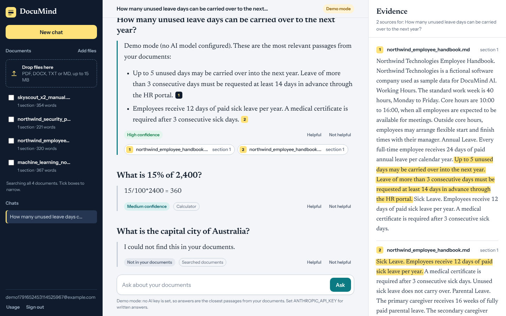
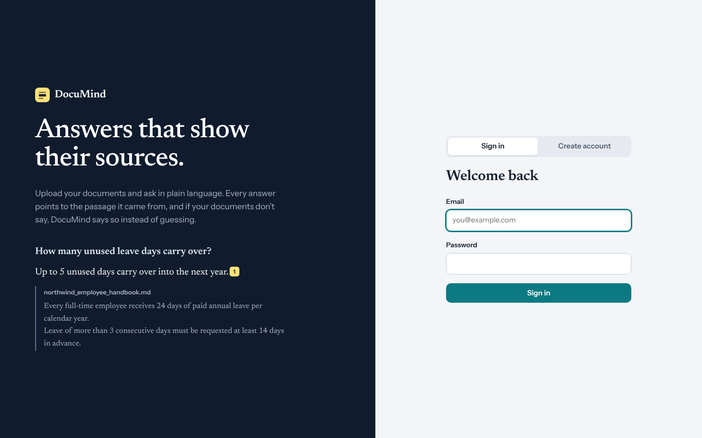
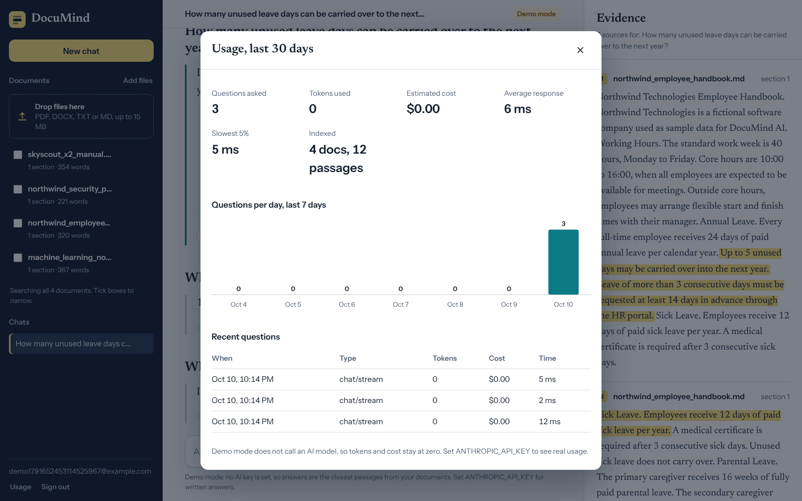
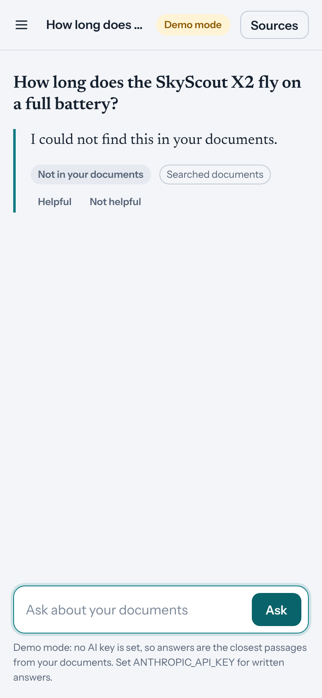

# DocuMind AI

**Answers that show their sources.** Upload your documents, ask in plain language, and get answers that cite the exact passage they came from. If your documents don't say, DocuMind says so instead of guessing.

DocuMind AI is a Retrieval-Augmented Generation (RAG) application with an agent layer, a FastAPI backend and a web interface. It is the Week 6 Master Project of the Python Programming and AI Development internship.



| Sign in | Usage dashboard | Mobile |
|---|---|---|
|  |  |  |

*Screenshots show demo mode (no API key), which returns the closest passages instead of written answers.*

---

## Features

- **Grounded answers with citations.** Click a citation to see the passage with the supporting sentence highlighted.
- **Honest refusals.** A similarity threshold, a strict prompt and citation validation keep the system from inventing answers.
- **Agent with tools.** Document search, a safe calculator, document statistics and whole-document summaries. The model picks the tool.
- **Streaming responses** over Server-Sent Events.
- **Accounts and privacy.** JWT login, and every vector query is filtered to the signed-in user's own documents.
- **Document library.** PDF, DOCX, TXT and Markdown, with validation, duplicate detection, and the option to search only selected documents.
- **Chat history and feedback** (helpful / not helpful) per answer.
- **Usage dashboard.** Questions, tokens, estimated cost and latency.
- **Demo mode.** Runs without an API key (retrieval only) so you can try everything locally.
- **Responsive interface** for desktop and phone.

## Architecture in one picture

```
Browser  ->  FastAPI  ->  Agent  ->  tools (search, calculate, stats, summarize)
                |           |
                |           +-> Retriever -> ChromaDB (vectors, per user)
                |           +-> Claude API (generation)
                +-> SQLite (users, documents, chats, usage)

Upload -> validate -> parse -> chunk -> embed -> index
```

Full details: [`docs/ARCHITECTURE.md`](docs/ARCHITECTURE.md). Day 1 plan: [`docs/PROJECT_PLAN.md`](docs/PROJECT_PLAN.md). Day 5 report: [`docs/FINAL_REPORT.md`](docs/FINAL_REPORT.md).

---

## Quick start

Requires Python 3.11 or newer.

```bash
# 1. Create and activate a virtual environment
python -m venv .venv
source .venv/bin/activate          # Windows: .venv\Scripts\activate

# 2. Install dependencies
pip install -r requirements.txt

# 3. Configure
cp .env.example .env               # Windows: copy .env.example .env
```

Edit `.env`:

- `JWT_SECRET`: set a long random value. Generate one with
  `python -c "import secrets; print(secrets.token_urlsafe(48))"`
- `ANTHROPIC_API_KEY`: add your key to get written answers. Leave it empty to run in demo mode.

```bash
# 4. Run
python -m uvicorn app.main:app --reload
```

Open <http://localhost:8000> for the app and <http://localhost:8000/docs> for the interactive API documentation.

**First run:** the embedding model (`all-MiniLM-L6-v2`, roughly 90 MB) is downloaded once, so you need internet access. Try it with the files in `data/samples/`.

### Try these questions with the sample documents

| Question | Shows |
|---|---|
| How many unused leave days can be carried over to the next year? | A cited answer and the evidence panel |
| What is 15% of 2,400? | The calculator tool |
| What is the capital city of Australia? | An honest refusal |

---

## Configuration

All settings are environment variables (or `.env`). The full list with comments is in [`.env.example`](.env.example). The important ones:

| Variable | Default | Purpose |
|---|---|---|
| `ANTHROPIC_API_KEY` | empty | Empty means demo mode |
| `LLM_MODEL` | `claude-sonnet-5-5` | Model used for answers |
| `JWT_SECRET` | placeholder | **Must be changed.** With `APP_ENV=production` the server refuses to start otherwise |
| `EMBEDDING_BACKEND` | `auto` | `auto`, `local` (require sentence-transformers) or `hash` (offline fallback) |
| `SIMILARITY_THRESHOLD` | per backend | Minimum similarity for a passage to count |
| `TOP_K`, `CHUNK_SIZE`, `CHUNK_OVERLAP` | 6, 800, 150 | Retrieval and chunking |
| `AGENT_MAX_STEPS` | 4 | Upper bound on tool-calling rounds |
| `PRICE_INPUT_PER_MTOK`, `PRICE_OUTPUT_PER_MTOK` | 3.0, 15.0 | Prices behind the cost estimate. Update them to match your model |
| `RATE_LIMIT_CHAT`, `RATE_LIMIT_AUTH`, `RATE_LIMIT_UPLOAD` | 30/10/20 per minute | Per-user rate limits |

---

## API

Interactive docs at `/docs`. Errors always use the shape `{"error": {"code": "...", "message": "..."}}`.

| Method | Path | Description |
|---|---|---|
| GET | `/api/health` | Status, mode, embedding backend, indexed chunks |
| POST | `/api/auth/register`, `/api/auth/login` | Create account, get a token |
| GET | `/api/auth/me` | Current user |
| POST | `/api/documents` | Upload and index a file |
| GET | `/api/documents` | List documents |
| DELETE | `/api/documents/{id}` | Delete a document and its vectors |
| POST | `/api/chat` | Ask a question (JSON) |
| POST | `/api/chat/stream` | Ask a question (Server-Sent Events: `status`, `token`, `reset`, `final`, `error`) |
| GET | `/api/sessions`, `/api/sessions/{id}/messages` | Chat history |
| DELETE | `/api/sessions/{id}` | Delete a chat |
| POST | `/api/messages/{id}/feedback` | Rate an answer |
| GET | `/api/usage` | Usage summary |

---

## Testing and evaluation

```bash
python -m pytest                    # 82 tests, all offline
python evaluation/run_eval.py       # 30-question evaluation, writes a report to evaluation/reports/
python evaluation/run_eval.py --judge   # also fact-check answers with the LLM (needs ANTHROPIC_API_KEY)
```

The tests use throw-away storage, the offline embedder and a scripted fake model, so they need no network and no API key.

### Evaluation results so far

Latest run (10 October 2026), **offline demo mode with hashing embeddings**. The 30 questions are 20 answerable and 10 unanswerable, over the four sample documents:

| Metric | Result | Target |
|---|---|---|
| Retrieval hit rate | 90.0% | 85% |
| Grounded answers | 70.0% | 90% |
| Unanswerable questions refused | 80.0% | 90% |
| Median latency | 3 ms | 6,000 ms |

These figures measure the offline fallback only. **The run with the real embedding model and Claude has not been done yet**, so run `python evaluation/run_eval.py --judge` on a machine with internet access and an API key, and use that result for your report.

---

## Docker

```bash
cp .env.example .env               # set JWT_SECRET (required) and optionally ANTHROPIC_API_KEY
docker compose up --build
```

The app is then at <http://localhost:8000>. Data lives in a named volume, so documents, chats and the downloaded embedding model survive restarts. The Dockerfile installs CPU-only PyTorch to keep the image smaller.

> The Dockerfile and compose file were written but **not built** in the environment this project was developed in (no Docker daemon available there). If the build fails on your machine, the error will point to the exact step.

---

## Security notes

- Passwords: SHA-256 pre-hash then bcrypt. Tokens: signed JWT with expiry.
- Every vector query and database lookup is scoped to the signed-in user. A test checks that users cannot read each other's data.
- Uploads: extension allow-list, size limit, sanitised filenames, duplicate detection.
- Uploaded text is passed to the model as delimited, untrusted data, and the prompt forbids following instructions inside it.
- Security headers include a Content-Security-Policy that allows only same-origin scripts.
- Never commit `.env`. It is already in `.gitignore`.

## Troubleshooting

| Symptom | Likely cause and fix |
|---|---|
| "I could not find this in your documents" for a question the document clearly answers | The offline hashing embedder is active, which needs word overlap. Open `/api/health`: if `embedding_backend` is `hash`, install the dependencies and allow the one-time model download, then set `EMBEDDING_BACKEND=local` to make that failure explicit. Re-upload your documents, because vectors from different backends are stored separately |
| Answers are just excerpts and the badge says "Demo mode" | `ANTHROPIC_API_KEY` is empty |
| Server exits at startup with a JWT message | `APP_ENV=production` with the default `JWT_SECRET`. Set a real secret |
| "No readable text was found in this file" | The PDF is scanned (no text layer). OCR is not included |
| HTTP 429 | A rate limit was hit. Adjust the `RATE_LIMIT_*` settings |

---

## Project structure

```
documind-ai/
├── app/
│   ├── main.py              application, middleware, security headers
│   ├── config.py            settings from environment
│   ├── logging_config.py    structured logging with request ids
│   ├── api/routes/          auth, documents, chat, sessions, usage, health
│   ├── ai/                  llm, prompts, embeddings, vectorstore, rag, agent, tools
│   ├── ingestion/           parsers, chunker, pipeline
│   ├── db/                  engine and ORM models
│   ├── schemas/             Pydantic request/response models
│   ├── core/                security, errors, rate limiting
│   └── static/              web interface (index.html, style.css, app.js, fonts)
├── tests/                   82 pytest tests
├── evaluation/              run_eval.py and generated reports
├── data/                    samples/ and eval/ (question set)
├── docs/                    plan, architecture, final report, screenshots
├── Dockerfile
├── docker-compose.yml
├── requirements.txt
└── .env.example
```

## Known limitations and future work

- No OCR for scanned documents.
- SQLite and an embedded vector store suit a single server; larger deployments would need PostgreSQL and a managed vector database.
- Ingestion runs inside the upload request, so very large files would need a background queue.
- Ideas: hybrid keyword and vector search with reranking, team workspaces, an optional local model through Ollama.

## Author

**Sikander Bin Iftiaz**, BS Artificial Intelligence, SZABIST
